# Current architecture flow (what exists in code)

Snapshot of branch `feature/m1-capability-registry-v2` at `c49150b` (clean tree, in sync with `origin/feature/m1-capability-registry-v2`). Read-only inspection: nothing was run and no code was changed. This is what the code does today, not the plan.

## Diagram

```mermaid
flowchart TD
  %% ---------- Console / UI ----------
  subgraph UI["Console (apps/console)"]
    BRIEF["Browser UI<br/>public/app.js, index.html"]
    API["Hono API<br/>src/app.ts (~1100 lines), server.ts"]
    SESS["In-memory Session map<br/>restored from checkpoint on resume"]
  end

  %% ---------- Intake ----------
  subgraph INTAKE["Intake"]
    UP["Upload, probe, vision, OCR<br/>packages/media"]
    ASR["Whisper transcription<br/>packages/speech"]
    ROUTER["Request router (LLM)<br/>packages/router"]
  end

  %% ---------- Director ----------
  subgraph DIR["Director (packages/director, LangGraph)"]
    G_INTAKE["intake"]
    ANALYSE["analyse_assets"]
    TREAT["treatment<br/>art direction, claims vs brand facts"]
    STORY["storyboard<br/>evidence-grounded ScenePlan"]
    GATE1{{"GATE 1<br/>storyboard_gate<br/>interrupt()"}}
    EDITPLAN["edit_plan<br/>recipe uses, production plan, compile, preflight"]
    GATE2{{"GATE 2<br/>edit_plan_gate<br/>interrupt()"}}
    ESC["escalated (end)"]
  end

  %% ---------- Knowledge ----------
  subgraph RAG["Retrieval (packages/rag)"]
    KW["KeywordRetriever (BM25)<br/>knowledge/ + recipes + brand facts"]
    HYB["HybridRetriever, embeddings, MMR<br/>bge-small, pgvector store"]
  end
  SKILLS["Skills (skills/*.md)<br/>SkillLibrary"]
  LLM["LlmClient<br/>AnthropicClient or DemoClient"]
  GW["ModelGateway, DbCallLog<br/>(budgets, call log)"]

  %% ---------- Capability + production planning ----------
  subgraph CAP["Capability registry + production planning"]
    RECIPES["Recipes (recipes/**/*.json)<br/>packages/recipes"]
    CAPREG["CapabilityRegistry, built per call<br/>render/capability-registry.ts"]
    LEARNED["capabilities/learned, capabilities/visual<br/>validated records"]
    PORT["ProductionPort (console implements it)<br/>capabilities(), preflight(), audio()"]
  end

  %% ---------- Approval persistence ----------
  subgraph STORE["Local file store (storage/sessions/id)"]
    RUNS["runs/run/approvals/N.json<br/>checkpoint.json, handoff.json<br/>RunStore"]
    ASSETS["storage/assets<br/>AssetRegistry"]
    RENDERS["renders/run/<br/>editor-output.json, records, evidence, out/*.mp4"]
  end

  %% ---------- Editor + render gate ----------
  HANDOFF["buildHandoff + verifyHandoffWithStore<br/>checkRenderable (approvals match plans)"]
  EDITOR["Editor: runEditor<br/>deterministic, no LLM"]
  PREP["prepare(): production gate<br/>verifyProductionForRender, replanAtActualSettings<br/>planRender, planAssembly"]
  RGATE{{"Render gate<br/>can_render / productionRefusal"}}

  %% ---------- Renderers ----------
  subgraph REND["Renderers (packages/render)"]
    ADREG["AdapterRegistry<br/>buildAdapterRegistry"]
    FF["FFmpeg adapter<br/>text, clips, xfade, audio mix"]
    RM["Remotion adapter<br/>scene-composition blocks<br/>Compositions.jsx"]
    HF["HyperFrames adapter<br/>text-fade, image-caption, asset-stage"]
    ASM["renderAssembly<br/>scene by scene, FFmpeg concat"]
    SG["Scene-graph v2 engine<br/>SCENE_GRAPH=off by default"]
  end

  subgraph QA["Post-render QA"]
    TQA["technical QA<br/>packages/qa"]
    VQA["visual QA, film quality<br/>visual-report.ts"]
    DEC["Delivery decision<br/>delivery-status.ts"]
  end
  OUT["Preview MP4 + delivery report<br/>(final_delivery_ready only if production-reviewed)"]

  %% flows
  BRIEF --> API --> SESS
  API --> UP
  API --> ASR
  API --> ROUTER
  ROUTER -. "uses LLM" .-> LLM
  UP --> ASSETS
  API -->|"POST /direct"| G_INTAKE
  G_INTAKE -->|"needs_clarification"| BRIEF
  G_INTAKE --> ANALYSE --> TREAT --> STORY --> GATE1
  GATE1 -->|"changes (max revisions)"| STORY
  GATE1 -->|"approved"| EDITPLAN --> GATE2
  GATE2 -->|"changes"| EDITPLAN
  STORY -. "issues" .-> ESC
  EDITPLAN -. "issues" .-> ESC
  GATE1 -. "revision limit" .-> ESC
  GATE2 -. "revision limit" .-> ESC
  GATE2 -->|"approved, binds production plan hash"| RUNS
  BRIEF -->|"POST /approve"| GATE1
  BRIEF -->|"POST /approve"| GATE2
  GATE1 -. "approvalLog.append before taking effect" .-> RUNS

  TREAT & STORY & EDITPLAN --> LLM
  TREAT & STORY & EDITPLAN --> SKILLS
  TREAT & STORY & EDITPLAN --> KW
  EDITPLAN --> PORT
  STORY -. "advisory feasibility" .-> PORT
  PORT --> CAPREG
  CAPREG --> RECIPES
  CAPREG --> LEARNED
  CAPREG --> ADREG
  KW -. "recipes marked implemented/validated per registry hash" .-> CAPREG
  GW -. "not wired to console" .-> LLM
  HYB -. "not wired to Director or console" .-> KW

  API -->|"GET /handoff"| HANDOFF
  HANDOFF --> RUNS
  API -->|"POST /editor"| EDITOR
  HANDOFF --> EDITOR --> RENDERS
  API -->|"POST /render, /render/plan"| PREP
  PREP --> HANDOFF
  PREP --> RUNS
  PREP --> CAPREG
  PREP --> RGATE
  RGATE -->|"refused: nothing starts"| BRIEF
  RGATE -->|"ok"| ASM
  ASM --> ADREG
  ADREG --> FF
  ADREG --> RM
  ADREG --> HF
  SG -. "not called by adapters" .-> RM
  ASM --> TQA
  ASM --> VQA --> DEC
  TQA --> DEC
  DEC --> OUT --> RENDERS
  OUT --> BRIEF
  API -.-> RENDERS
```

Reading the diagram: solid arrows are called in the normal path. Dotted arrows are optional, one-directional hints, or unwired (labelled).

## The path in words

1. **Brief and assets.** The browser UI posts to the Hono app (`apps/console/src/app.ts`). Uploads are probed, analysed and described locally (`packages/media`), speech is transcribed with Whisper (`packages/speech`), and the optional router (`packages/router`) turns chat into a structured request.
2. **Director graph** (`packages/director/src/graph.ts`, LangGraph, graph version `director-graph/4`): `intake` -> `analyse_assets` -> `treatment` -> `storyboard` -> **Gate 1** -> `edit_plan` -> **Gate 2** -> end (`status: approved`). A change request at a gate goes back to the node that made the plan and returns to the same gate. After `MAX_REVISIONS_PER_GATE` it escalates. The gate uses `interrupt()`, so state is held by the checkpointer until `/approve` resumes it.
3. **Evidence grounding.** Claims in the treatment are checked against approved brand facts (`enforceClaims`), the storyboard is validated against assets and notes (`planIssues`), and each approval record stores plan hash, storyboard version and an evidence hash.
4. **Gate 1 advisory.** If a production port is attached, `adviseFeasibility` reports what the live registry can plausibly make. It selects nothing and blocks nothing.
5. **Edit plan and production plan.** `editPlanNode` offers the model only recipes the live registry says can run (`candidateRecipes`), then `produceFor` builds a production decision plan, compiles it deterministically (`production/compile.ts`) and runs the renderers' own preflight planners through the `ProductionPort`. The Director never imports the render package. The console implements the port.
6. **Gate 2.** Before showing the proposal the gate re-verifies the production plans (`verifyProductionIntegrity`, `validateProductionPlan`) and refreshes them if capabilities changed. On approval it stores a `production_binding` hash in the approval record. The record is appended to disk before the decision takes effect (`RunStore.approvalLog`).
7. **Handoff and Editor.** `buildHandoff` plus `verifyHandoffWithStore` refuse unless both approvals match the current plans and asset files hash correctly. `runEditor` is deterministic and makes no model call. Its output is saved as `renders/<run>/editor-output.json`, bound to the handoff content hash.
8. **Render gate** is a composite, in `prepare()` in `app.ts` and `render/production-gate.ts`: the stored approvals, plan integrity, the live registry, the Editor's operations and a re-plan at the real output settings must all agree. Any mismatch returns 409 with one plain sentence and starts nothing.
9. **Rendering.** `planRender` or `planAssembly` picks adapters through `AdapterRegistry`. A one-engine film runs as a single render. Otherwise `renderAssembly` renders each scene with its own engine (FFmpeg, Remotion, HyperFrames) and assembles with FFmpeg (xfade, concat, audio mix). Learnable gaps are closed by `learnGaps`, which renders a real test and stores a validated record under `capabilities/learned`.
10. **QA and delivery.** Technical QA (`packages/qa`), visual QA on the finished film, and `delivery-status.ts` combine into one decision: `final_delivery_ready`, `complete_preview` or `incomplete_preview`. Output is an MP4 plus JSON reports under `storage/sessions/<id>/renders/<run>/`.

## Module legend

| Area | Path | Status |
|---|---|---|
| Console server and API | `apps/console/src/server.ts`, `src/app.ts`, `src/render-service.ts`, `src/public-view.ts` | Live. Sessions are held in an in-memory `Map`; only checkpoints, approvals, handoffs and render outputs persist (files). `127.0.0.1` only, no auth. |
| Browser UI | `apps/console/public/app.js`, `index.html`, `styles.css` | Live. Plain JS, no framework. |
| Contracts (zod schemas) | `packages/contracts/src/*` (`director.ts`, `approval.ts`, `production.ts`, `capability.ts`, `render.ts`, `handoff.ts`, `editor.ts`, `visual*.ts`, `scene-graph.ts`) | Live. `scene-graph.ts` and `templates.ts` are contracts only. |
| Director graph, gates | `packages/director/src/graph.ts`, `nodes.ts`, `approvals.ts` | Live. |
| Production planning | `packages/director/src/production/{plan,compile,integrity,advisory}.ts` | Live when the console supplies a `ProductionPort`. Without a port the Director still runs, but with no production plan (older fixtures and CLI). |
| Handoff, run store, resume | `packages/director/src/{handoff,store,resume}.ts` | Live. File-based under `storage/sessions/<id>/runs/<run>/`. Hashes protect against accident, not a hostile writer (the file says so). |
| Editor | `packages/director/src/editor-agent.ts` | Live, deterministic. |
| LLM client and skills | `director/src/llm.ts`, `skills.ts`, `skills/*/SKILL.md`, `skills/editor/*` | Live. `AnthropicClient` needs `ANTHROPIC_API_KEY`. `DemoClient` with `--demo` / `DEMO=1`. |
| Model gateway | `packages/director/src/gateway.ts` | **Unwired.** Budgets, price table, `DbCallLog`. Nothing outside its own test imports `ModelGateway`. |
| Router | `packages/router/src/router.ts` | Live via `POST /api/sessions/:id/route` and the evals. |
| Media understanding | `packages/media/src` | Live (probe, analysis, local vision, OCR if available). |
| Speech | `packages/speech/src/engine.ts` | Live (Whisper, local model cache in `storage/models`). |
| Keyword RAG | `packages/rag/src/keyword.ts`, `docs.ts`, `scopes.ts`; content in `knowledge/` | Live. This is the only retriever the console and Director use. |
| Hybrid RAG, embeddings, rerank | `packages/rag/src/{hybrid,embeddings,rerank,templates}.ts` | **Unwired** to Director and console. Used by `npm run eval:hybrid` and `npm run templates`. Local `bge-small-en-v1.5` only when on disk, else hash embedder. |
| Postgres and pgvector | `docker-compose.yml`, `db/migrations/0001_pgvector_foundation.sql`, `rag/src/db/*`, `scripts/db.mts` | **Unwired** to the app. Reachable only through `npm run db:*` and `templates`. `DATABASE_URL` is not read by the console. |
| Recipes | `recipes/**/*.json`, `packages/recipes/src` | Live. `RECIPES_MODE=reviewed` makes draft recipes unavailable. Default is `draft`, so nothing is production-reviewed by default. |
| Capability registry | `packages/render/src/capability-registry.ts`, `capabilities.ts`, `registry-cache.ts`, `adapter-registry.ts`; data in `capabilities/learned/*`, `capabilities/visual/*` | Live. Rebuilt per call. Only live adapters make a capability executable. |
| Render planning and gate | `render/src/{render,assemble,production-gate,preflight,selection-integrity,coverage}.ts` | Live. |
| FFmpeg adapter | `render/src/ffmpeg.ts`, `audio.ts` | Live (needs `ffmpeg`, `ffprobe` on PATH and a font file). |
| Remotion adapter | `render/src/remotion.ts`, `composition.ts`, `remotion-compositions/Compositions.jsx`, `remotion-project/` | Live (needs a local Chrome, nothing is downloaded). 14 visual blocks in `capabilities/visual/*`, validated against the current `Compositions.jsx` (HEAD commit). |
| HyperFrames adapter | `render/src/hyperframes.ts`, `hyperframes-stage.ts`, `hyperframes-composed.ts` | Live (needs Chrome). Only text-fade, image-caption, asset-stage and learned composed scenes. No clips, transitions or audio. |
| Scene-graph v2 engine | `contracts/src/scene-graph.ts`, `render/src/scene-graph/{validate,compile,presets}.ts`, `render/remotion-scene-graph/*` | **Feature-flagged and unwired.** `sceneGraphEnabled()` is `SCENE_GRAPH=on`, default off. Nothing outside tests calls the compiler or the `remotion-scene-graph` bundle, so no adapter can produce a scene-graph render yet. |
| QA | `packages/qa/src/{technical,visual}.ts`, `render/src/visual-report.ts`, `delivery-status.ts` | Live. `final_delivery_ready` stays false for any film using draft or preview-only recipes. |
| Evals | `packages/evals`, `evals/*.json`, `evals/baselines/*` | Dev tooling: `npm run eval`, `eval:retrieval`, `eval:hybrid`. Not on the runtime path. |

## Feature flags and switches (all of them read from code)

| Switch | Effect | Default |
|---|---|---|
| `SCENE_GRAPH=on` | Enables the scene-graph v2 engine (`sceneGraphEnabled`). Currently has no runtime effect because the compiler is not called by any adapter. | off |
| `RECIPES_MODE=reviewed` | Only reviewed recipes are available. | `draft` |
| `--demo` / `DEMO=1` | Canned `DemoClient` instead of Claude. | off |
| `ANTHROPIC_API_KEY`, `ANTHROPIC_MODEL` | Real model. Default model id is `claude-sonnet-5-5`. | unset |
| `RENDER_FONT_FILE` | Required for any adapter to exist. Falls back to Arial or DejaVu if present. | system font |
| `WHISPER_MODEL`, `WHISPER_CACHE_DIR` | Local transcription model and cache. | `Xenova/whisper-base`, `storage/models` |
| `PORT`, `HOST` | Console bind. | `4173`, `127.0.0.1` |
| `DATABASE_URL`, `STORAGE_DRIVER`, `SESSION_SECRET` | Present in `.env.example` only. **No console or Director code reads them.** Only `scripts/db.mts` reads `DATABASE_URL`. | n/a |

## Unwired or not yet connected (summary)

- `ModelGateway` / `DbCallLog` (budgets, call logging): no caller.
- Hybrid retrieval, embeddings, template ingest: eval and script use only. The Director gets BM25 only.
- Postgres / pgvector: schema and store exist, the app does not use them. Sessions live in memory and files.
- Scene-graph v2: contracts, validator, compiler, Remotion composition and presets exist, behind a default-off flag, and no adapter calls it.
- No auth, and no multi-user storage: `STORAGE_DRIVER` and `SESSION_SECRET` are placeholders.

## Not visible from this checkout

The brief asked me to mark anything that lives only on the unpushed D: PC branches. I cannot see that machine, so I cannot say what is there. In this repo:

- Local branches are `feature/m1-capability-registry-v2` (pushed, up to date with origin), `feature/two-approval-gates` (the base, origin HEAD) and `backup/pre-rag-implementation`. There are no other worktrees and no stashes.
- No document in the repo names the D: PC branches.

Anything not listed above and expected to exist should be treated as **only on the D: PC branches** until it shows up in a push. To close that gap, someone can run `git branch -vv` and `git log --oneline origin/feature/m1-capability-registry-v2..HEAD` on the D: PC and compare it with this file.

## Caveats on this document

- Based on reading the code and the call sites; I did not run the app or the tests, so "live" means wired in the code path, not "verified working today". The last commit says the 14 visual capabilities were re-validated against real renders.
- `apps/console/src/app.ts` is large and I read the session, direct, approve, handoff, editor and render routes closely. I skimmed the asset review, gallery and correction routes.
