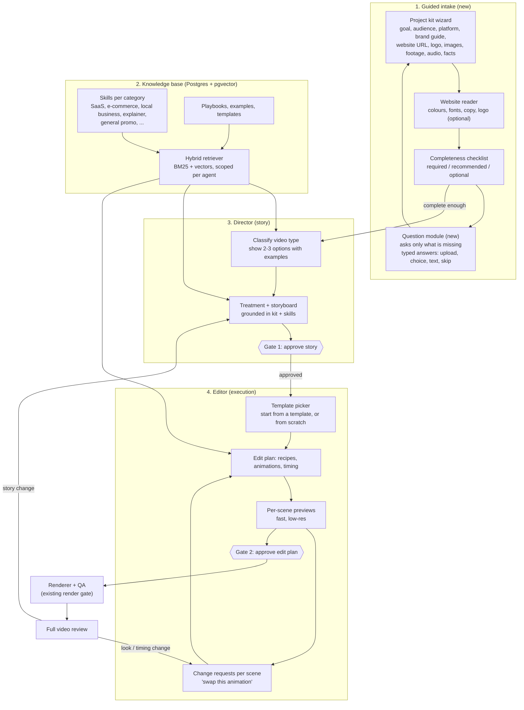

# Target architecture proposal

Proposal only. No code has been changed. It builds on `CURRENT_ARCHITECTURE_FLOW.md` (what exists today, branch `feature/m1-capability-registry-v2`).

## What you asked for, in my words

1. **Guided intake, not an open prompt.** The product collects everything a video needs: brand guidelines, website, logo, images, footage, audio, facts, goal, audience, platform. With a good UX.
2. **A question module.** After intake, it asks follow-ups based on what it learned ("do you have a logo?" shows an upload box, with a Skip choice and edge cases handled).
3. **A real skills knowledge base in Postgres + pgvector**, covering video categories (SaaS, e-commerce, general promo, ...). The Director uses it to write the story and must be able to show the user what kind of video this will be.
4. **Templates the user can pick** (offered by the Director or the Editor), then keep editing.
5. **Director approves story, then the Editor** (with its own rich skills) shows scene previews, takes change requests ("I don't like this animation"), then the renderer.
6. **Changes after the full video review.** Director and Editor keep clear roles, and the "brain" is optimized.

## How it maps to what exists

| Your need | Today | Gap |
|---|---|---|
| Collect brand/assets | Upload, probe, vision/OCR, Whisper, brand facts list, router chat (`packages/media`, `speech`, `router`, console) | No brand-guideline, website or logo intake. Facts are typed in, one list. No structured "project kit". |
| Follow-up questions | Director `intake` node can return `needs_clarification`; router asks up to 3 rounds | Questions are free text from the model. No asset-specific requests ("upload your logo"), no skip, no completeness checklist. |
| Skills + RAG in Postgres | Skills are 9 markdown files; RAG is BM25 over ~15 notes; pgvector schema and hybrid retriever exist but are not wired | Needs a real corpus per category, ingestion, and the retriever wired into both agents. |
| Show the user what video type | Treatment has an art-direction "visual system" | Not presented to the user as a choice with examples. |
| Pick a template | Recipes (building blocks); `digikon.template` library ingest exists | Not offered to the user; no "start from this template" path. |
| Scene previews | Render preview exists only after both gates | No per-scene preview before approval. |
| Editor takes change requests | Editor is deterministic and only compiles; no model | No user-facing edit loop at the scene level. |
| Changes after the final video | None (a new run) | Needs "revise" without redoing everything. |
| Roles | Director plans, Editor compiles | Roles are right in principle. They need to be sharpened (below). |

## Target flow

## Roles

- **Director owns meaning:** what the video says, who it is for, the story, the claims, the scene list and its duration. Changes to any of these re-open Gate 1.
- **Editor owns execution:** animations, templates, timing within a scene, transitions, audio mix, text styling. Changes here re-open Gate 2 only, and never touch the story.
- **Rule for routing a change request:** a short classifier (with the skills) decides "story change" or "look change". When unsure, it asks the user in one sentence.
- Both agents read the same knowledge base through scopes that already exist (`AGENT_SCOPES`).

## Phases (each shippable, in this order)

**Phase 1: Project kit and intake UX.** A wizard that collects goal, audience, platform, brand colours/fonts/logo, brand guideline file (PDF), website URL, assets and facts. A readiness checklist (required / recommended / optional) with Skip on everything optional. Edge cases: no logo, no website, unreadable PDF, site blocks scraping, huge or wrong file types, user changes mind. Stored as a versioned "project kit" that the Director reads.

**Phase 2: Question module.** Takes the kit and asks only what is missing, one structured question at a time, each with a typed answer (upload, pick, short text, Skip). Stops when the checklist is satisfied or the user says "go". Builds on the Director's `intake` node and the router.

**Phase 3: Knowledge base in Postgres + pgvector.** Wire the existing schema, ingest, and `HybridRetriever` into the console. Author skills per category (see questions) and put them in `knowledge/` with metadata: category, funnel stage, platform, quality grade. Use the dev/test retrieval benchmark that exists (`evals/`) to prove the new corpus helps. Needs Postgres running (`docker-compose`).

**Phase 4: Director shows video type and story.** A classifier step proposes 2-3 video types with a one-line description and a reference example. The user picks one, then the treatment and storyboard follow that category's skills.

**Phase 5: Templates and Editor.** Offer templates at Gate 1 or on the Editor screen. Add an Editor model with its skills, scene-level change requests, and fast scene previews (the render adapters already render single scenes).

**Phase 6: Post-review revision.** After full video review, route the change to the Director or the Editor and re-render only what changed.

**Phase 7: Optimise.** Add the model gateway (budgets, call log), caching, and the scene-graph engine if the visual blocks need it.

## Decisions I need from you

1. **Categories and priority:** which video types first? (I suggest SaaS, e-commerce, general promo.) Do you have an ordered list?
2. **Skills source:** which repos or documents will you give me, and should I also search public repos? I will check licences before using anything.
3. **Website intake:** read the site automatically (colours, fonts, text), or only take the URL as a reference?
4. **Hosting:** is Postgres + pgvector local (Docker) for now, or a hosted database?
5. **Scene previews:** are low-res moving previews acceptable, or do you need still frames only at first?
